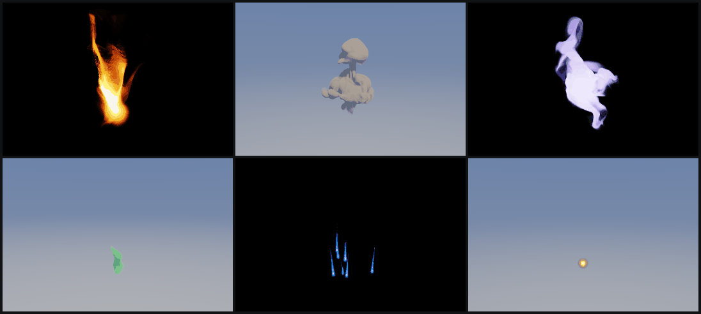
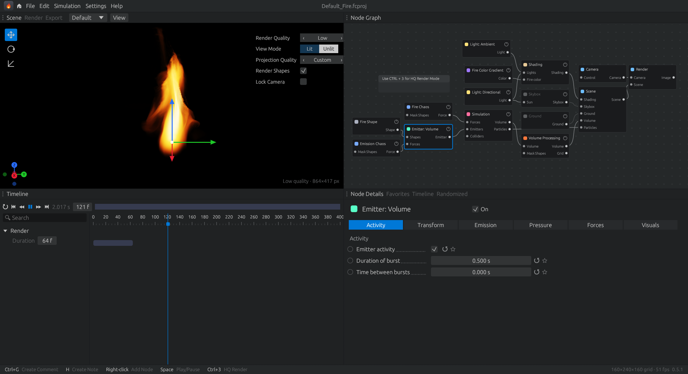
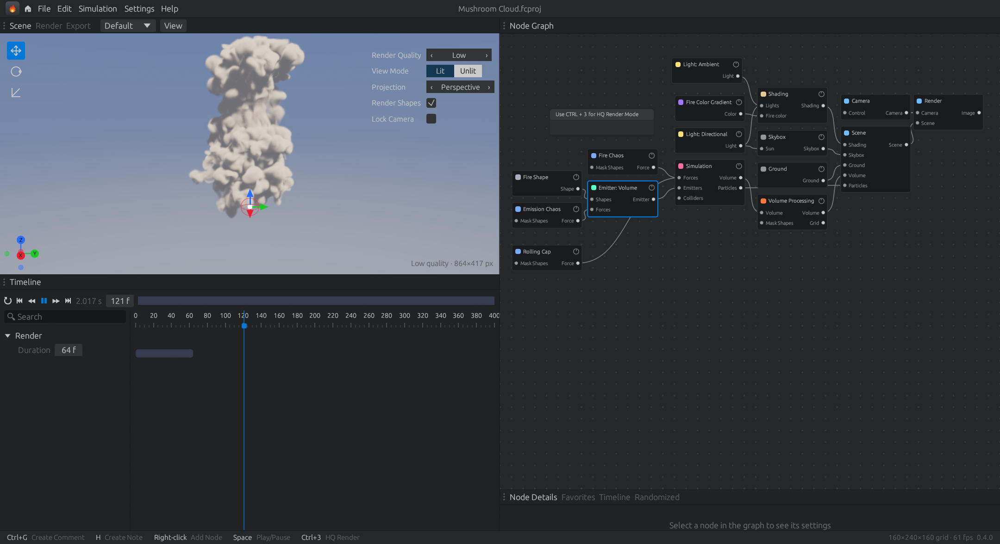
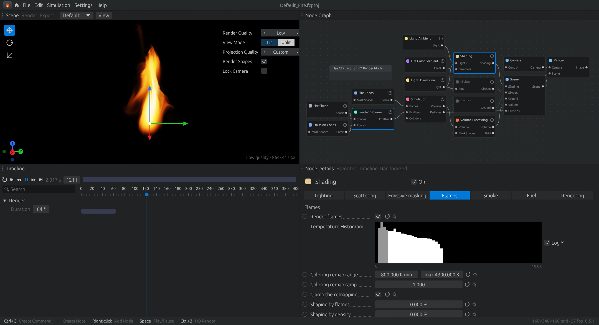
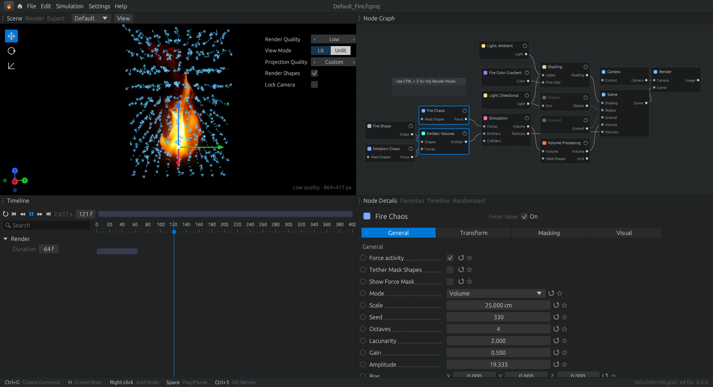
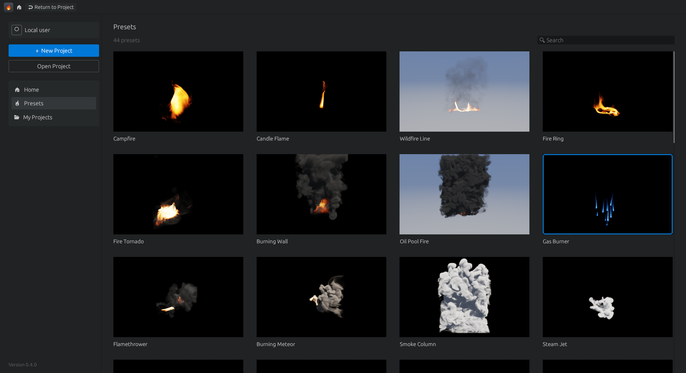
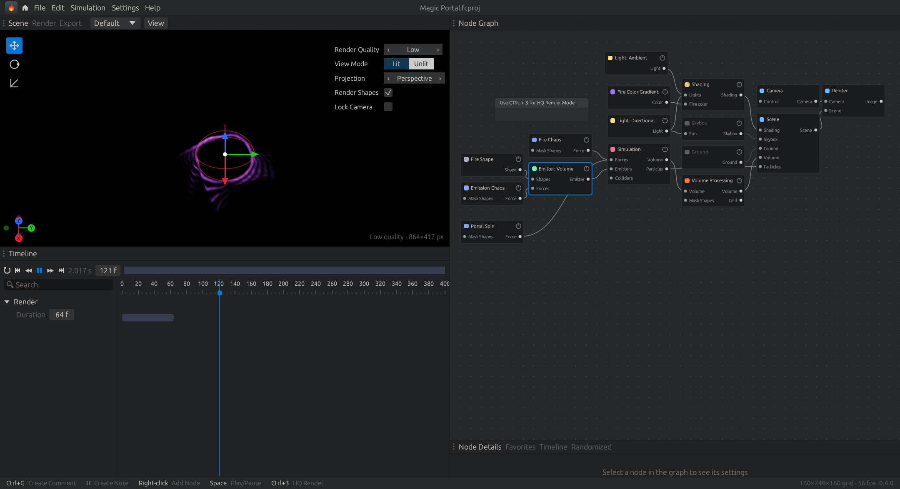
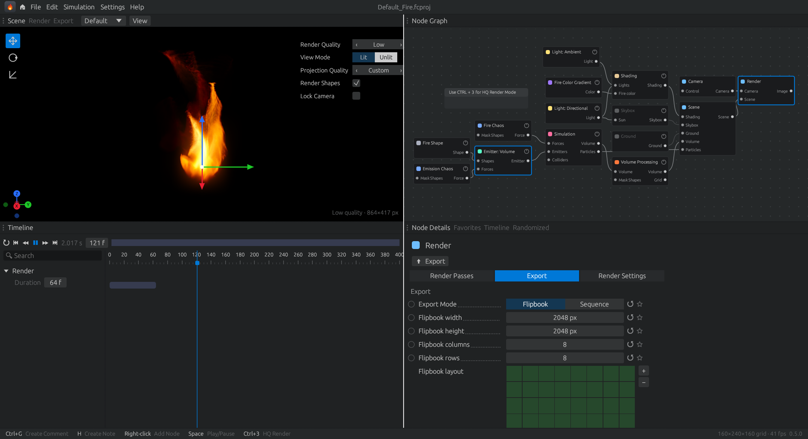

<div align="center">


# FireCraft

**Fire, smoke and explosions — simulated live on your GPU, shaped with nodes.**

A real-time volumetric effects tool, built in pure Rust for Windows, macOS and Linux.

[](#how-its-built)
[](#how-its-built)
[](#downloads)
[](#feature-status)
[](#releasing-a-new-version)



<sub><i>Six built-in presets simulating in real time — campfire, mushroom cloud, magic portal, spirit swirl, gas burner, ground explosion. Every frame is a live 3D fluid simulation, not a sprite.</i></sub>

[Simulate](#simulate-fire-the-way-it-actually-moves) · [Nodes](#a-node-graph-for-every-part-of-the-effect) · [Settings](#every-setting-in-its-own-tab) · [Presets](#44-presets-no-two-alike) · [Render](#render-quality-that-holds-up-close) · [Export](#export) · [Downloads](#downloads) · [Build](#quick-start) · [Release](#releasing-a-new-version) · [Changelog](CHANGELOG.md)

</div>

---

<a href="docs/screenshot-main.png"></a>

<sub><i>The workspace: live 3D viewport (top left), node graph (top right), timeline (bottom left) and the selected node's settings (bottom right).</i></sub>

## Simulate fire the way it actually moves

FireCraft runs a full 3D fluid solver on the graphics card every frame. Fuel burns, hot gas rises, smoke billows and cools — you change a setting and watch the effect respond immediately.

- **Real combustion**: emitters release fuel and heat. Fuel ignites smoothly above its ignition temperature and burns into heat, smoke and *flames*, and the flames fade as the gas cools. You choose how much of each it makes, the burn rate, the ignition temperature and the expansion.
- **Sharp, stable flames** — a staggered (MAC) grid, midpoint back-tracing and a red-black SOR + Gauss-Seidel pressure solve keep flame sheets crisp and free of grain, even at 36 million cells.
- **Turbulence that folds, not shreds** — curl-noise forces swirl the gas into sheets and tongues; the strength fades smoothly around the effect so edges never break up into noise.
- **Detail on tap**: set the voxel count and the voxel size in centimetres, and move the bounds to wrap the grid tightly around your effect. Grids go up to 48 million voxels, and the app keeps the grid inside what your graphics card can hold.
- **Physical controls**: dissipation (multiplicative and subtractive) and diffusion for each channel. Vorticity with velocity, temperature and smoke masks. Buoyancy, smoke and fuel weight, gravity, solid walls on any side, wind with chaos, shredding, and a domain mask.
- **Open boundaries** — gas leaves the simulated space and fades out softly; nothing piles into a box.
- **Time control**: timestep, substeps, freeze and looping. **Projection quality**: Low, Medium, High, Ultra or Custom. **Advection**: first, second or third order. **Colliders** for walls, ceilings, pillars and pipes.

## A node graph for every part of the effect

<a href="docs/screenshot-mushroom.png"></a>

<sub><i>The Mushroom Cloud preset: a burst emitter plus a Force: Toroidal node rolls the cap.</i></sub>

Right-click the graph for the full library — searchable, grouped like a pro tool, with **Create Comment** (Ctrl+G) and **Create Note** (H). Drag between ports to wire, rename any node, turn nodes on and off.

| Group | Nodes |
|---|---|
| **Shape** | Primitive (sphere · box · cylinder · torus, stretchable) · Burst (expanding shell) · Particles · Noise · Transform · Blend · Modifier (hollow, resize, soft edge) |
| **Emitter** | Volume · Particles (flying, falling, glowing sparks) |
| **Collider** | solid shapes the gas flows around |
| **Force** | Line · Toroidal (smoke rings) · Noise (curl turbulence) · Point (push / pull) · Vector Field (swirl · updraft · in · out) · Vorticles — each can be masked to a soft-edged shape |
| **Modulator** | Constant · Oscillator · Cycle · Math · Time Shift · Combine · ADSR · MIDI — right-click any setting › *Drive with modulator* |
| **Light** | Ambient · Directional (with volumetric shadows) · Point |
| **Camera** | Orbit · Free |
| **Color** | Gradient · Constant · Blackbody |
| **Import / Export** | Import a volume as the starting state · Export image sequence · flipbook · volume |
| **Scene** | Skybox · Ground · Scene · Simulation · Shading · Volume Processing · Render |

Everything you expect from a desktop app is there: **undo / redo**, cut / copy / paste / duplicate nodes, multi-select and box select, right-click menus on nodes, settings, viewport and timeline, favourites and randomise for settings, and projects you can save, reopen and double-click.

## Every setting in its own tab

<a href="docs/screenshot-shading.png"></a>

<sub><i>The Shading node's Flames tab: a live histogram of temperatures in the simulation, beside the colour remap range it controls.</i></sub>

Each node shows its settings in tabs, just like the big tools do. Advanced settings stay hidden until you need them, and settings that don't apply are hidden too.

| Node | Tabs |
|---|---|
| **Simulation** | Domain · Simulation · Time Control · Projection · Combustion · Dissipation · Diffusion · Vorticity · Force · Wind · Shredding · Mask · Visual · Particles |
| **Emitter** | Activity · Transform (with rotation) · Emission · Pressure (with random pressure) · Forces (transfers the emitter's own motion) · Visuals (can emit light) |
| **Forces** | General · Transform · Masking (temperature, smoke and velocity masks with ranges) · Visual (arrows in the viewport) |
| **Shading** | Lighting · Scattering · Emissive masking · Flames · Smoke · Fuel · Rendering, with live temperature and smoke histograms |
| **Fire Color Gradient** | Gradient editor with RGB, Linear, HSV or OKLab blending; import and export `.fcgrad` files or a PNG strip |
| **Scene** | Tonemapping · Colors (bloom, swizzle) · Vignetting · Style |
| **Volume Processing** | Post process (motion blur, sharpen, dilate) · Post modulation · Slicing mask |
| **Render** | Render Passes · Export · Render Settings |

<a href="docs/screenshot-forces.png"></a>

<sub><i>Select a force and its field appears as arrows in the viewport. This is the Fire Chaos curl noise, with scale, seed, octaves, lacunarity, gain, amplitude and bias.</i></sub>

## 44 presets, no two alike

<a href="docs/screenshot-presets.png"></a>

<sub><i>The home screen. Every preset picture is pre-rendered in high quality and ships inside the app.</i></sub>

Candle flame · wildfire line · fire ring · fire tornado · burning wall · oil pool fire · blue gas burner · flamethrower · burning meteor · smoke column · steam jet · smoke ring · incense wisps · smoke under a ceiling · smoke around a pillar · ground fog · storm cloud · twin tornadoes · smoke grenade · dry-ice waterfall · billowing puffs · ground explosion · aerial fireball · mushroom cloud · muzzle flash · dust impact · artillery blast with debris · chain explosion · magic portal · wandering fireballs · energy orb · nebula · toxic cloud · spirit swirl · sparks fountain · campfire with embers · rocket launch · firework burst · volcanic eruption · pipe leak · wind tunnel · cooling tower · exhaust vents — and the default campfire. Each one is a real node graph you can open and take apart.

## Render quality that holds up close

<a href="docs/screenshot-portal.png"></a>

<sub><i>Magic Portal: a torus emitter spun by a Vector Field node, coloured by a purple gradient.</i></sub>

- **GPU ray marching** through a hardware-filtered 3D texture, at full screen resolution, with empty-space skipping.
- **Emission + absorption** shading with self-shadowing smoke, ambient, directional and point lights, skybox and ground.
- **Low-noise sampling** — interleaved-gradient jitter averaged over frames; pause and **HQ mode** (Ctrl+3) refines the frame over up to 256 passes for clean stills.
- **The 0.4 look, guaranteed**: a test renders the default scene and compares every pixel with pictures the 0.4.0 build made. Today's build matches them exactly.
- **Render Quality**: Low, Medium or High; Lit or Unlit; perspective or orthographic; emitter and force gizmos; an axis widget.

## Export

<a href="docs/screenshot-export.png"></a>

- **Render passes**: Render All, Alpha, Emission, Scattering, Temperature, Density, Fuel or Depth. Each is written as RGBA, RGB or a single channel, and can be HDR.
- **PNG, EXR (HDR floats) or TGA**, with filename patterns such as `$(project)_$(safename)`.
- **Image sequence**: one file per frame at any size, with first frame, frame count, stride, a numbering offset and absolute frame numbers.
- **Flipbook**: every frame tiled into one sprite sheet, ready for game engines. You set the columns and rows on a visual grid.
- **Volume** — density, temperature and fuel as 3D grids (`.vol`), and back in through the Import node.
- Export with **Export Now** on the Render node, from the **Export tab**, or from **Export nodes** in the graph. Exports run frame by frame without freezing the app, and **Open Folder** takes you to the files.

## Fast, native, yours

- One native executable per platform. No runtime, no account, no network.
- Simulation and rendering run entirely on your GPU; the app paces itself so memory stays flat even at Ultra.
- Projects are plain text (`.fcproj`) — easy to diff, easy to share.

## Feature status

| Area | Status |
|---|---|
| 3D fire / smoke / fuel simulation, combustion, colliders, wind | ✅ |
| Node graph, full node library, modulators | ✅ |
| Viewport, lighting, shadows, HQ refinement | ✅ |
| Presets (44, pre-rendered pictures) | ✅ |
| Undo / redo, clipboard, project files | ✅ |
| Full node settings (tabs, advanced settings, gradients, histograms, force gizmos) | ✅ |
| Render passes (alpha, emission, scattering, temperature, density, fuel, depth), PNG · EXR · TGA | ✅ |
| Settings the engine doesn't use yet (shown dimmed in the panel): tonemapping, bloom and styles, flame shaping, diffusion, masks, shredding and more | ⬜ being connected one by one |
| Image sequence · flipbook (PNG · EXR · TGA) · `.vol` volume export, volume import | ✅ |
| *Import control* and *Force Tightness* settings | ⬜ shown, not yet active |
| Windows installer · macOS universal app · Linux AppImage, automatic releases | ✅ |
| MIDI modulator | ✅ Windows · ⬜ macOS / Linux |
| OpenVDB (`.vdb`) export | ⬜ (`.vol` for now) |
| Keyframed timeline animation, particle rendering beyond sparks | ⬜ |
| Signed / notarised installers | ⬜ |

✅ done · 🚧 in progress · ⬜ not yet

## Downloads

> **Get the latest version:** open **[Releases › Latest](../../releases/latest)** and pick your platform. Every release also has `SHA256SUMS.txt` for checking downloads.

### Windows

| Build | File | Notes |
|---|---|---|
| **Installer** (recommended) | `FireCraft-<version>-windows-x64-setup.exe` | One click, no admin rights; Start-menu + desktop shortcut, opens `.fcproj` files. |
| Portable | `FireCraft-<version>-windows-x64-portable.zip` | Unzip and run `FireCraft.exe`. |

The installer isn't code-signed yet, so Windows SmartScreen may say *"Windows protected your PC"* — click **More info › Run anyway**.

### macOS

| Build | File | Notes |
|---|---|---|
| **Universal app** (Apple Silicon + Intel) | `FireCraft-<version>-macos-universal.dmg` | Open, drag **FireCraft** to **Applications**. |

The app isn't notarised yet: the first time, **right-click FireCraft › Open › Open** (or *System Settings › Privacy & Security › Open Anyway*). Requires macOS 11+.

### Linux

| Build | File | Notes |
|---|---|---|
| **AppImage** (recommended) | `FireCraft-<version>-linux-x86_64.AppImage` | `chmod +x` it and double-click. Runs on most distributions. |
| Tarball | `FireCraft-<version>-linux-x86_64.tar.gz` | The bare `firecraft` binary. |

Needs a Vulkan-capable GPU driver (Mesa or the vendor driver).

**All platforms:** a GPU with DirectX 12, Vulkan or Metal. High and Ultra detail need a recent discrete GPU (Ultra uses about 3 GB of graphics memory).

## Quick start

Build from source with Rust 1.85 or newer:

```sh
git clone <this repository>
cd firecraft
cargo run --release
```

On Linux install the windowing libraries first: `sudo apt install libxkbcommon-dev libwayland-dev libx11-dev libxcursor-dev libxrandr-dev libxi-dev libgtk-3-dev`.

Useful commands:

```sh
cargo test                                   # unit tests (one test renders on the GPU)
cargo test render_preset_pictures -- --ignored   # re-render the built-in preset pictures (~6 min)
cargo run --release -- my_project.fcproj     # open a project
cargo run --release -- --screenshot out.png  # render ~120 frames, save the window, exit
```

## How it's built

| Layer | Where | What |
|---|---|---|
| App, panels, menus | `src/main.rs` | eframe / egui UI, viewport, timeline, exports, undo, shortcuts |
| Node graph | `src/graph.rs` | node library, ports and wiring, settings panel, project files |
| Simulation | `src/sim.wgsl`, `src/gpu.rs` | GPU compute: MAC-grid fluid, combustion, forces, colliders, pressure solve |
| Rendering | `src/render.wgsl`, `src/post.wgsl` | GPU ray marcher with shadows, lights and sparks; bloom, tonemapping, styles and passes |
| Setting widgets | `src/widgets.rs`, `src/noise.rs` | gradient editor, render passes, histograms, noise preview, export helpers |
| Presets | `src/presets.rs`, `assets/presets/` | preset graphs and their pre-rendered pictures |
| Modulators | `src/modulate.rs` | values over time and MIDI input |
| Home screen | `src/home.rs` | presets gallery, recent projects |
| Packaging | `packaging/`, `.github/workflows/` | installers and automatic releases |

Pure Rust on [wgpu](https://wgpu.rs) (DirectX 12 · Vulkan · Metal) and [egui](https://github.com/emilk/egui).

## Releasing a new version

Releases are automatic. Bump the version and push:

```powershell
powershell -ExecutionPolicy Bypass -File scripts\bump.ps1 0.5.0
```

(or edit `version` in `Cargo.toml` and push to `main`). First add a `## [0.6.0]` section to [CHANGELOG.md](CHANGELOG.md): it becomes the release notes. The **Release** workflow notices the new version, builds the Windows installer, the macOS universal `.dmg` and the Linux AppImage, and publishes them as release `v0.6.0` with checksums — about 15 minutes. Pushes that don't change the version are built and tested by **CI** on all three platforms but not released.

First-time setup of the repository is a single command: `scripts\publish.ps1` (creates the private repository under the organization and pushes).

## License and credits

© Circuit Biscuit. All rights reserved — private repository.

Built with Rust, wgpu, egui / eframe, image, rfd and winresource.
